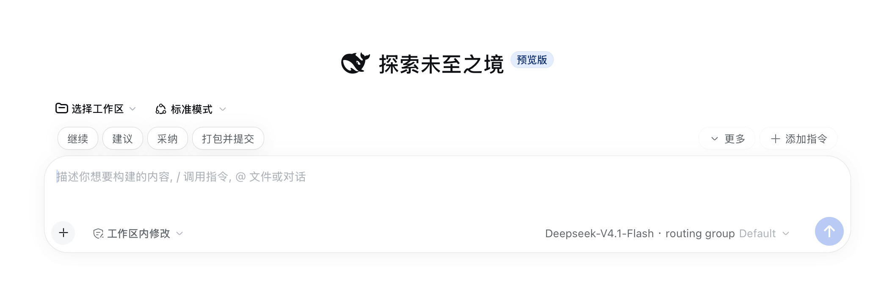
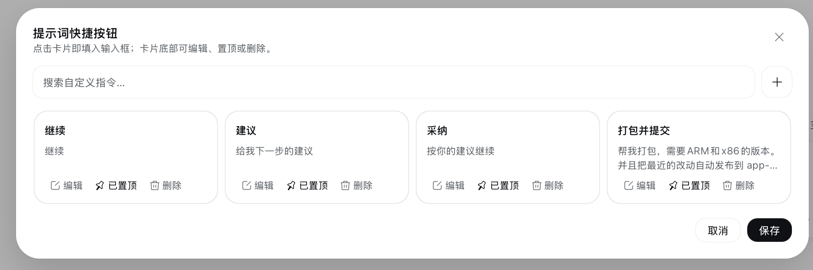
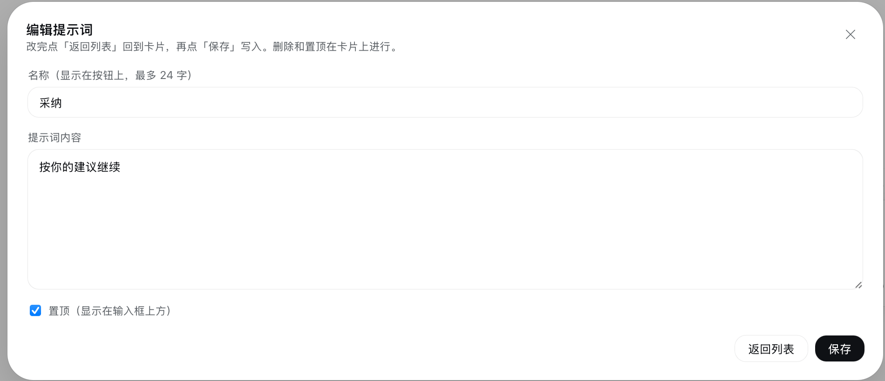

# DSH Prompt Shortcuts

把常用提示词存成输入框上方的一排快捷按钮，点一下就能填进输入框；支持 `{{变量}}` 占位符、中/英文双版本自动切换、一键生成英文版，管理入口在「设置 → 自定义指令」。

> 包名说明：本包是 `dsh-prompt-shortcuts` 的自定义构建（custom build）。npm 包名为
> **`dsh-plugin-prompt-shortcuts`**（`dsh-prompts` 已被他人占用）。基于
> [cdredfox/dsh-prompt-shortcuts](https://github.com/cdredfox/dsh-prompt-shortcuts) 二次开发，
> MIT 许可。



一个 DeepSeek Harness 插件。装好之后，每次打开会话都能看到自己预设的提示词按钮，不用再反复手打或者去别处复制粘贴。

## 界面

**管理入口**——「设置 → 自定义指令」，卡片网格列出全部提示词，支持搜索；卡片底部可直接编辑、设置位置、生成英文版或删除。



**编辑单条**——点卡片上的「编辑」进入，改完点「返回列表」回卡片，再点「保存」写入。



## 功能

**输入框上方的快捷按钮栏**

每个启用的提示词是一个按钮，点击后**替换**输入框当前内容。鼠标悬停可以看到完整提示词。

**变量占位符**

提示词内容支持 `{{变量名}}` 占位符（如 `{{文件名}}`、`{{指定语言}}`）。点击按钮后如果该提示词含变量，会先弹出一个填写表单，填完才把替换好的文本填入输入框。

**按钮位置（placement）**

每条提示词可以单独选择出现在哪里：

| 位置 | 说明 |
|---|---|
| `both`（默认） | 新建会话页 + 已有会话的输入框上方都显示 |
| `hero` | 仅新建会话页显示（模式选择右侧，按宽度收纳进「更多」） |
| `active` | 仅有会话的输入框上方显示 |

**中英文双版本**

每条提示词可以填一份英文版（`labelEn` / `promptEn`）。界面语言切到英文时按钮和填入内容自动用英文版，切回中文自动用中文版；`{{变量}}` 在两个版本里要保持同名同序。没有填英文版时，任何语言下都用中文版。

**一键生成英文版**

编辑页里点「生成英文版」：用你在 DSH 界面当前选择的模型把名称和提示词翻译成英文，结果**先展示、不自动保存**，确认后才随「保存」写入。翻译走 Host 侧（有 60 秒硬超时、输出长度上限、一次静默重试），翻译过程中可以取消。

**自动收纳**

按钮排不下时不会换行，放不下的自动收进「更多」。按钮栏始终是一行，窗口拉窄也不会变形。

**「更多」下拉菜单**

列出所有没显示在按钮栏上的提示词。点一条直接填入。

## 安装

推荐从 npm 安装已发布的稳定版本：

```sh
dsh plugin --profile web add dsh-plugin-prompt-shortcuts
```

把 `web` 换成你实际使用的 profile 名（例如 `tauri`）。安装完成后**重启 `dsh web`、刷新浏览器**，按钮栏就会出现在输入框上方。

安装过程会把这个包加入 profile 的依赖和 bundle 列表；卸载用：

```sh
dsh plugin --profile web remove dsh-plugin-prompt-shortcuts
```

**从源码安装**（想改代码或试用未发布版本时）：

```sh
git clone https://github.com/foxworld306/DSH-Plugins.git
cd DSH-Plugins/dsh-plugin-prompt-shortcuts
dsh plugin --profile web add link:"$PWD"
```

`link:` 安装是符号链接（开发流）：改代码后无需重装，Host 半边改动重启 `dsh web` 即可。

### 环境要求

- DSH 版本需包含 `conversation.input.dock` / `conversation.hero.options` / `settings.section` 槽位（`package.json` 的 `engines.dsh` 声明了验证过的范围）
- 浏览器端依赖 `@deepseek-ai/dsh-client-store`（DSH Web 自带，无需单独安装）
- 无构建步骤、无运行时依赖：`index.js` 与 `client.js` 直接就是可加载的模块

### 升级后请注意

`1.1.0` 起提示词改存到 Host 的 JSON 文件（见[数据存储](#数据存储)）。`1.0.x` 存在浏览器 `localStorage` 里的旧数据**不会自动迁移**——首次升级后看到的是三条默认提示词，需要按需重新录入。

从 `1.0.x` 升级前，可以先在浏览器开发者工具里导出旧数据：

```js
localStorage.getItem('dsh-prompt-shortcuts/v1')
```

从 npm 包名 `dsh-prompts` 迁移到 `dsh-plugin-prompt-shortcuts`：`remove` 旧包名 + `add` 新包名即可，数据文件不受影响。

## 使用

| 操作 | 结果 |
|---|---|
| 点按钮栏上的提示词 | 替换输入框内容（含变量时先弹变量表单） |
| 点「更多」 | 展开未显示的提示词列表 |
| 设置 → 自定义指令 | 打开管理页（卡片网格 + 搜索） |
| 管理页点卡片 | 填入输入框并关闭面板 |
| 管理页点「编辑」 | 修改名称、内容、位置、英文版 |
| 管理页点「生成英文版」 | 用当前模型翻译，确认后随保存写入 |
| 管理页点「删除」 | 删除（需二次确认） |

## 数据存储

提示词存成 Host 侧的一个 JSON 文件：

```
$DSH_HOME/prompt-shortcuts.json     # 未设置 DSH_HOME 时为 ~/.dsh/prompt-shortcuts.json
```

数据归 DSH 所有，**不随浏览器缓存丢失**——换浏览器、换设备、清空站点数据都不影响。

写入采用**原子替换**（先写临时文件再 `rename`），并且所有写入串行排队：写一半被打断不会留下损坏文件，连续快速保存也不会互相覆盖。文件是普通 JSON，可以直接查看、用 Git 管理或手工编辑（手工改坏的行会在下次读取时被跳过，不会让按钮栏整体失效）。

结构很简单：

```json
{
  "shortcuts": [
    {
      "id": "seed-continue",
      "label": "继续",
      "prompt": "继续",
      "enabled": true,
      "placement": "both",
      "labelEn": "Continue",
      "promptEn": "Continue"
    }
  ]
}
```

- `enabled` 表示这一条是否显示；
- `placement` 可选 `both` / `hero` / `active`（缺省 `both`）；
- `labelEn` / `promptEn` 可选，UI 为英文时使用。

**路径可覆盖**：插件行支持两个可选配置项——`dshHome`（替换 `$DSH_HOME`）和 `file`（直接指定文件路径），用于多环境或同步目录。

首次使用时会有三条默认提示词（继续 / 建议 / 采纳），可以自行修改或删除。

## Agent 也能读写

除了界面操作，插件还注册了一个 Agent 工具 `prompt_shortcuts`，可以直接在对话里让 Agent 维护提示词：

> 帮我加一条提示词，名字叫「跑测试」，内容是「运行 {{文件名}} 的全部测试并修复失败项」

> 把「建议」那条改成「给我三个可选方案，并说明取舍」

工具支持 `list` / `save` / `remove` / `translate` 四个动作，与界面走同一份存储和同一套校验，不存在两边数据不一致的问题。`translate` 只返回结果、不落盘，是否写入由你（或 Agent 随后的 `save`）决定。

## 设计说明

插件挂在三个槽位上：`conversation.input.dock`（输入框上方的整宽条目，和官方的排队提示条同一个位置）、`conversation.hero.options`（新建会话页右侧紧凑选项区）、`settings.section`（设置页一级导航 + 内容列）。槽位注册里的 `label` 用** thunk**（`() => string`）提供——槽位契约规定投影时会重读 thunk，所以按钮栏/hero 栏的标签跟随 UI 语言无需重新注册；设置页导航项则沿用「语言变化时注销重注册」的官方模式。

样式全部使用 DSH 的主题变量（`--dsw-alias-*`、`--dsw-radius-*`），因此自动跟随明暗主题和字号设置。按钮的视觉语言对齐了输入框卡片本身：白底、无实线边框（靠 `.5px` 阴影描边）、柔和投影。

按钮的宽度是**实测**的，不是按字符数估算——中文和英文混排、字号变化时估算都会失准。插件在屏幕外渲染一份副本量出真实宽度，再用 `ResizeObserver` 跟踪变化。

浏览器端通过插件自有的 HTTP 路由 `/api/dsh-prompt-shortcuts` 读写数据（`POST`，JSON），而不是绕道通用 RPC——路径是写死的，出问题时可以直接用 curl 验证。

## 已知限制

**图标是内联的。** DSH 的图标集 `@deepseek-ai/dsh-client-ui-primitives` 不对插件开放导入，所以这几个图标的 SVG 路径是复制进来的。如果 DSH 之后改了图标，这里不会自动跟着变。

**变量表单是简单文本输入。** `{{变量}}` 的值按纯文本收集，没有类型、必填或长度校验。

**按钮栏只读，编辑在管理页里。** 想改内容要进「设置 → 自定义指令」，按钮本身只负责填入。

**翻译依赖当前默认模型。** 没选默认模型时「生成英文版」不可用；翻译结果由模型产出，请检查后再保存。

## 文件结构

```
dsh-prompt-shortcuts/
├── package.json         插件清单（dsh.bundle 与 dsh.client 声明、engines）
├── cordis.patch.yml     Cordis 加载器的插件行插入（id: prompt-shortcuts）
├── index.js             Host 半边：文件存储、HTTP 路由、Agent 工具
├── client.js            全部界面逻辑（按钮栏 / hero 栏 / 设置页 / 变量表单）
├── icon.svg             插件图标
├── locale/
│   ├── en.json          插件列表显示元数据（英文）
│   └── zh.json          插件列表显示元数据（中文）
├── docs/
│   ├── preview-row.png  按钮栏截图
│   ├── m1.png           管理页截图
│   └── m2.png           编辑提示词截图
└── LICENSE              MIT
```

`index.js` 是 Host 半边：`ShortcutStore` 负责读写与校验，`webServer` 路由暴露给浏览器，`prompt_shortcuts` 工具暴露给 Agent——三者共用同一份实现。`client.js` 只负责界面，不含任何持久化逻辑。整个包没有构建步骤，也没有运行时依赖。

## 开发

改代码后重装 bundle 并重启 `dsh web`：

```sh
dsh plugin --profile web add link:"$PWD"   # 或 remove 后重新 add
```

Host 半边（`index.js`）的改动**必须重启进程**才生效；只有浏览器端 `client.js` 的改动可以靠刷新页面或内置 HMR 加载。

调试数据接口时可以直接 curl（`$TOKEN` 取启动日志里 `?token=` 后面的值）：

```sh
curl -X POST "http://127.0.0.1:3080/api/dsh-prompt-shortcuts?token=$TOKEN" \
  -H 'content-type: application/json' \
  -d '{"action":"list"}'
```

发布新版本：

```sh
npm version minor   # 或 patch / major
npm publish
```

`publishConfig` 已固定为官方 registry 与 public access，无需额外参数。若 npm 开启了 2FA，`npm publish` 会要求完成一次浏览器验证。

## 更新日志

### 1.5.1

- **npm 包名改为 `dsh-plugin-prompt-shortcuts`**（`dsh-prompts` 已被占用；数据文件与安装行 id `prompt-shortcuts` 不变，升级不受影响）
- 插件清单补 `dsh.manifestVersion: 1` 与 `engines`（node/dsh 范围），Host 工具补齐 `(args, exec)` 签名并接入宿主取消信号（翻译中途可被宿主中断）
- 按钮栏 / hero 栏槽位 `label` 改为 thunk，跟随 UI 语言（中文「提示词快捷按钮」/ 英文 "Prompt shortcut buttons"）
- README 全面重写（补上 `{{变量}}`、placement、中英文双版本、生成英文版、设置页等内容；原 README 停在 1.1.2 且误称"不支持变量"）

### 1.2 – 1.5.0（补记：此前漏记，按代码能力回填）

- 提示词支持 `{{变量}}` 占位符，点击时先填变量表单
- 每条提示词支持 `placement`（`both` / `hero` / `active`），新建会话页 hero 行（模式选择右侧）新增按钮位
- 管理入口迁移到「设置 → 自定义指令」一级页面；按钮栏不再带「添加指令」按钮
- 每条提示词支持 `labelEn` / `promptEn` 双版本，随 UI 语言自动切换
- 新增「生成英文版」：用当前默认模型一键翻译（仅返回结果，不自动保存）
- `prompt_shortcuts` 工具新增 `translate` 动作

### 1.1.2

- 仓库更名为 `dsh-prompt-shortcuts`，同步更新 `package.json` 中的仓库、主页和 issue 地址

### 1.1.1

- 插件列表里显示中文名称和描述（新增 `locale/zh.json` 与 `locale/en.json`），不再是原始包名
- README 换成真机截图

### 1.1.0

- **提示词改存 Host 文件**（`$DSH_HOME/prompt-shortcuts.json`），不再使用浏览器 `localStorage`，清理浏览器数据不会再丢
- 新增 `prompt_shortcuts` Agent 工具，可以在对话里让 Agent 增删改提示词
- 默认提示词改为「继续 / 建议 / 采纳」
- 修复安装包更名后客户端模块 id 未同步导致的启动失败

**升级须知**：`1.0.x` 的 `localStorage` 数据不会自动迁移。

### 1.0.0

首个版本：输入框上方的快捷按钮栏、置顶控制、溢出自动收纳、维护面板。

## 贡献

Issue 与 PR：[github.com/foxworld306/DSH-Plugins/issues](https://github.com/foxworld306/DSH-Plugins/issues)（DSH-Plugins 仓库共用）。本包为自定义 fork，原始项目归属见[许可](#许可)。

## 许可

[MIT](LICENSE)。原始项目：[dsh-prompt-shortcuts](https://github.com/cdredfox/dsh-prompt-shortcuts)（Copyright (c) 2025 DSH Prompt Shortcuts contributors）。
